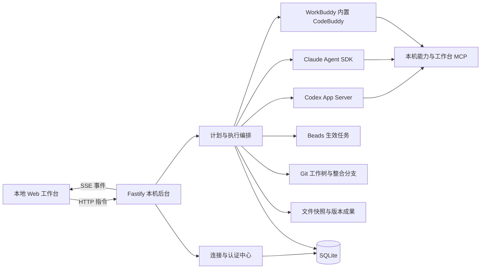
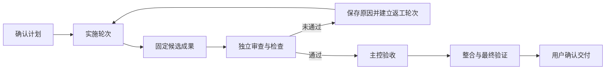

# 本地多 Agent 工作台升级方案

> 接入、编排、专业协作与成果交付

| 项目 | 说明 |
| --- | --- |
| 文档版本 | 1.9 |
| 公开整理日期 | 2026-10-21 |
| 适用项目 | 爱丽丝的魔杖 · 本地多 Agent 工作台 |
| 文档性质 | 基于已确认需求整理的升级设计与验收依据 |
| 当前状态 | 开发中的公开源码；计划和验收标准不代表已完成全部验收。 |
| 执行记录 | Beads 为任务生命周期的权威来源；本文件不作为第二套进度台账 |

## 1. 产品目标与范围

将现有工作台升级为面向软件开发、办公分析和专业设计任务的本地协作环境。用户在一个界面中配置执行工具、组织团队、确认计划、介入执行并核对最终成果。

完整使用路径：

**启用执行工具 → 配置原生账号或 API → 创建团队 → 提交目标与资料 → 确认计划 → 自动协作 → 审查返工 → 验收 → 确认交付。**

### 1.1 已确定的产品原则

| 维度 | 确定方案 |
| --- | --- |
| 应用形态 | 本地 Web＋本机后台，仅监听本机；浏览器关闭不停止后台任务 |
| 技术基础 | React、TypeScript、Fastify、SQLite、Beads、Git |
| 执行工具 | Codex、Claude Code、WorkBuddy；任务仍由原生执行工具运行 |
| 模型来源 | 原生配置、官方模型 API、符合指定协议的兼容网关 |
| 团队形式 | 固定核心团队＋按需专家；每个项目一个主控，默认最多三个普通成员并行 |
| 执行授权 | 用户确认整份计划后自动推进；超出已确认范围的修订重新确认 |
| 交付授权 | 先形成可验收版本；更新目标分支、覆盖原件、推送或实际部署前确认 |
| 视觉方向 | 保留黑白界面、02 静态背景、桌面分栏；优先保证文字辨认和操作空间 |
| 账号策略 | 每种执行工具共享一个原生登录；支持多个 API 连接，成员独立选择连接 |
| 外部能力 | 本轮支持官方模型 API、兼容模型网关、本机 MCP 和本地技能／脚本 |
| 兼容要求 | 保留现有项目、成员、会话、附件、Token 记录和工作树 |

同一种执行工具可以创建多个成员；多个成员也可以引用同一连接，共享其额度和限流。

### 1.2 本轮不包含的内容

- 独立桌面客户端和多用户账户系统。
- 同一种工具的多个订阅账号并行管理。
- 同步原生桌面客户端的全部历史会话或侧栏。
- 工作台管理的远程 MCP，以及外部业务系统 OAuth。
- 新建企业云 IAM 环境的向导；已存在的原生企业配置可继续沿用并核对。
- 未接入真实工具时，以角色名称或演示数据代替图像生成、文档转换、设备操作等实际能力。

## 2. 总体架构与事实来源

浏览器负责配置、交互与展示；本机后台负责认证衔接、队列、执行控制、幂等、状态恢复和交付动作。原生工具负责模型调用及其工具执行。

| 信息 | 权威来源与保存方式 |
| --- | --- |
| 生效任务、负责人、依赖、生命周期 | Beads |
| 代码、提交、工作树、分支与整合结果 | Git |
| 团队、连接配置、计划版本、画布布局 | SQLite |
| 会话映射、执行轮次、指令回执、审批与运行事件 | SQLite |
| Token 记录 | 原生工具回执；SQLite 保存来源、范围与关联信息 |
| 文件输入、输出和成果版本 | 工作台管理目录中的文件快照及内容哈希 |
| 原生认证 | 原生工具自己的认证存储和刷新机制 |
| 工作台新增 API Key | 后端使用 Windows DPAPI 加密；数据库保存密文或凭据引用 |

SQLite 不另建一套与 Beads 竞争的生效任务生命周期。未确认的计划属于草稿；确认后才映射为 Beads 任务。

## 3. Agent 接入与认证中心

### 3.1 成员、工具、连接与模型

成员配置由以下部分组成：

**专业角色＋执行工具＋连接配置＋模型＋工具能力＋明确的调度权限。**

- 角色决定工作职责和默认要求。
- 执行工具决定会话协议、执行环境和原生控制能力。
- 连接决定认证来源、供应商、服务地址及协议。
- 模型是该连接下的具体模型选择。
- 能力决定该成员实际能使用哪些 MCP、技能或脚本。
- 主控调度权限独立配置，不能通过修改成员名称或角色文案获得。

工作台本身无需注册账号。没有可用认证或模型服务时，仍可管理项目、保存团队和计划，但不能向相关成员自动派发任务。

### 3.2 三种工具的启用路径

| 执行工具 | 原生登录路径 | API 路径 | 工作台接入方式 |
| --- | --- | --- | --- |
| Codex | 沿用本机认证；官方浏览器或设备码登录 | OpenAI 官方 API；首版支持 Responses 协议兼容网关 | App Server 的账号读取、登录开始、完成通知、取消及执行控制 |
| Claude Code | 沿用本机认证；引导原生登录 | Anthropic 官方 API；Anthropic Messages 兼容网关 | 原生认证入口＋Agent SDK，通过安全认证状态和实际运行回执确认来源 |
| WorkBuddy | 使用内置 CodeBuddy CLI 的原生登录 | CodeBuddy 官方 API；按原生配置支持 Anthropic／OpenAI 兼容服务 | 内置执行层的 headless／双向 stream-json 会话，独立检查 CLI 认证与真实调用 |

采用官方原生认证流程，不自行实现账号密码登录，不复制订阅令牌。浏览器授权、终端输入回调码等由用户在原生界面完成。

WorkBuddy 桌面登录与工作台启动的内置 CLI 登录分开验证，不假定二者自动共享账号。WorkBuddy 接入不要求其执行会话出现在桌面侧栏。

“兼容 OpenAI”不是通用于三个执行工具的协议保证。网关必须按具体运行时、协议、连接版本和模型分别验证。

### 3.3 首次启用向导

1. **检测安装**：展示程序路径、版本与兼容情况；缺失时提供官方安装入口及手动指定路径。
2. **选择连接**：沿用本机配置、打开原生登录，或新增 API 配置。
3. **检查认证**：读取安全状态，显示实际凭据来源和提供方；无法判断的字段保持未知。
4. **选择模型**：读取当前连接的模型目录；发现失败时允许手动填写模型 ID。
5. **验证调用**：用户明确点击后发起真实请求，记录模型回执、能力证据和 Token。
6. **绑定成员**：确定连接、模型及能力，进入可执行状态。

原生登录界面提供等待、取消、失败、重新检测入口。共享账号发生切换前，列出同工具下所有受影响成员，并先处理正在执行或状态未知的会话。

普通刷新只读取状态和模型元数据，不自动发起模型推理。验证按钮说明会产生调用用量；短提示也可能携带较大的原生系统上下文，不能承诺固定或极低的 Token 数量。

### 3.4 API 连接配置

| 字段 | 要求 |
| --- | --- |
| 连接名称 | 用户可识别的名称 |
| 执行工具 | Codex、Claude Code 或 WorkBuddy |
| 接入方式 | 原生继承、官方 API、兼容网关 |
| 提供方与协议 | 明确供应商和请求协议，不只填写泛化的“兼容 API” |
| 服务地址 | 官方默认端点或自定义 Base URL |
| 站点／区域 | CodeBuddy 区分中国站、国际站和既有企业环境 |
| 凭据 | API Key 或后端凭据引用；仅写入，不通过查询接口返回原值 |
| 模型 | 默认模型、目录以及手动模型 ID |
| 配置版本 | 每次影响路由或认证的修改生成新版本 |
| 验证记录 | 配置版本、时间、请求模型、实际模型、结果及已验证能力 |

官方配置提供默认端点。兼容网关至少验证真实推理、流式输出和工具调用；图片、用量等能力单独记录，未观察到成功证据时不标为支持。

### 3.5 状态与验证规则

状态分层展示：

| 层次 | 示例 |
| --- | --- |
| 安装状态 | 未安装、已检测、版本待兼容 |
| 配置与认证 | 未配置、检测到认证、认证失败、存在覆盖冲突 |
| 调用验证 | 未验证、当前配置和模型已验证 |
| 调用异常 | 额度不足、模型不可用、网络失败、原因未知 |
| 能力验证 | 流式／工具调用／图片／用量分别已验证或未验证 |

模型目录仅代表可选项，不代表模型可调用、账号有权限或余额充足。自动派发前核对成员所选连接、配置版本、模型及必需能力，并在计划确认页集中提示缺项。

### 3.6 凭据、隔离与会话绑定

- 工作台新增密钥留在后端，不进入聊天、事件日志、浏览器持久存储或项目仓库。
- 原生认证由原生工具保存和刷新；工作台不接管订阅令牌刷新逻辑。
- API 连接通过子进程环境和工作台管理的独立配置目录生效，不修改系统全局环境变量或原生全局配置。
- 检测竞争认证变量、项目配置覆盖和模型路由冲突；不能保证使用所选连接时阻止派发并说明原因。
- 原生会话绑定连接 ID 和配置版本。更换服务地址、认证来源或连接后建立新会话，保留旧会话及交接记录。
- 不因认证失败或额度不足自动切换账号、供应商、网关或计费渠道。
- “解除工作台绑定”与“退出原生账号”是两个动作；退出影响共享该原生登录的成员。
- 未读取到的余额、限额、供应商和底层模型保持未知，不通过名称推断。

## 4. 专业团队与角色模板

### 4.1 核心团队

| 项目类型 | 预置核心团队 |
| --- | --- |
| 开发项目 | 主控／编排＋全栈开发＋独立审查 |
| 办公项目 | 主控／编排＋数据分析＋独立审查 |

主控默认使用 Codex。成员可选择其他已配置的执行工具、连接和模型；角色不硬绑定模型。其他专家根据任务创建或复用，默认最多三个普通成员同时执行。

### 4.2 模板清单

| 模板 | 主要职责 | 典型成果 |
| --- | --- | --- |
| 主控／编排 | 拆解目标、选人、协调依赖、处理阻塞和验收 | 计划、分工、问题与交付说明 |
| 全栈开发 | 前后端实现、接口实现与开发测试 | 候选提交、测试证据 |
| 独立审查 | 对固定版本独立审查 | 问题位置、等级、影响与结论 |
| 测试质量 | 用例设计、自动化测试、实际使用验收 | 测试用例、命令、日志与验证结果 |
| 产品与交互 | 需求、流程与交互设计 | 需求说明、流程、高保真原型 |
| 架构与接口 | 模块边界、契约和系统结构 | 接口契约、架构图、网络拓扑 |
| 数据分析 | 口径、清洗、分析与图表 | 分析结论、图表、可复现脚本 |
| 文档与报告 | 内容组织和文档制作 | Word、Excel、PPT、PDF |
| 运维与交付 | 环境、CI/CD、诊断和部署准备 | 流水线、部署准备、验证与回滚说明 |
| 硬件与嵌入式 | 固件、协议、编译、模拟和设备验证 | 固件、协议实现、编译与设备证据 |
| 视觉设计 | 设计图、素材和效果图 | 实际设计文件及工具生成图像 |

模板包含默认指令、权限、必需能力、输入要求和验收要求。应用模板不得批量覆盖已有成员的自定义指令；明确应用新指令时才更新。

设计图、接口契约、网络拓扑、测试用例和高保真原型首先是成果类型，不需要各自建立一个常驻 Agent。一个专业角色可按任务输出多种成果。

### 4.3 权限与能力边界

专业角色、调度权限和工具能力分开建模。将成员改名为“主控”不能获得调度权限；选择“视觉设计”也不代表已经接入图像生成。

独立审查读取固定候选版本，由另一成员完成。设备验证、浏览器验收、图像生成和文档转换必须对应真实工具；缺失时显示能力缺口。

## 5. 工作台界面与操作结构

### 5.1 页面区域

| 区域 | 功能 |
| --- | --- |
| 左侧项目与团队 | 项目切换、核心成员、按需专家、运行状态 |
| 会话 | 真实消息、附件、模型入口、统一发送／停止 |
| 编排 | 任务依赖、分工、进度、阻塞和人工检查点 |
| 成果 | 代码、文件、测试、审查、整合与交付记录 |
| 右侧详情 | 选中任务的目标、输入、负责人、工具、执行记录和验收项 |
| 待你处理 | 计划确认、问题回答、工具审批、认证异常、恢复和交付 |
| 设置 | 接入中心、角色模板、能力中心、项目规则 |

左右面板可调整和收起，记住项目内视图与选中任务。以 **1440×900、1920×1080** 桌面视口验收；窄窗口折叠辅助面板。

保留 02 静态背景；文字区域通过局部遮罩和面板对比保证辨认，不用降低全页可读性来突出背景。

### 5.2 输入、停止和人工接管

- 模型选择保留在输入框下方，和附件、发送／停止入口集中布置。
- 默认“发送即纠正”：成员执行中收到人工新指令时，先中断、确认停止，再在同会话继续。
- “下一轮补充”作为明确可选操作，不与立即纠正混淆。
- 中断保留已产生的代码、文件与成果，不代表撤销。
- 人工接管后禁止主控向该成员自动发送新指令；交还后先核对最新会话、任务与成果。
- 暂停工作流只停止新派发；停止当前成员需要使用中断操作。

## 6. 计划与编排画布

### 6.1 画布表现

使用 `@xyflow/react` 构建任务画布，使用 `@dagrejs/dagre` 自动排列。

节点代表真实任务，显示名称、负责人、执行工具、状态和阻塞原因；详细模型、Token、日志、输入和成果放在详情面板。

首版支持：

- 主控生成计划，用户编辑未执行任务。
- 连接依赖、并行汇合、独立审查、人工确认。
- 缩放、自动排列、拖动与保存布局。
- 功能开发、分析报告、设计原型三个流程模板。
- 计划确认、修订影响说明、暂停和恢复。

### 6.2 计划确认与修订

1. 草稿保存任务、分工、输入、依赖、必需能力和验收条件。
2. 确认页集中检查连接、模型、能力、负责人及依赖是否可执行。
3. 用户确认整份计划后固定版本，以稳定标识创建或核对 Beads 任务。
4. 后台按依赖和并发限制自动推进。
5. 修改负责人、依赖、输入、工作范围或验收要求时形成修订，并展示受影响节点。
6. 超出已确认范围的修订需要重新确认；已完成节点不自动重跑。

拖动节点只改变布局，不改变依赖、任务状态或执行授权。部分 Beads 任务创建失败时先核对已有记录，不重新创建整套任务。

### 6.3 依赖和审查

| 依赖类型 | 启动条件 |
| --- | --- |
| 普通依赖 | 前置任务通过验收；需要代码时从核对后的整合提交开始 |
| 候选审查依赖 | 实施成员停止、候选版本固定，审查读取该候选；实施任务可保持待验收 |
| 人工确认节点 | 前置条件满足，并记录用户确认说明 |

首版采用无环依赖图。返工通过新的执行轮次表达，不在依赖图上创建循环边，也不为启动审查而提前关闭实施任务。

## 7. 本机能力、MCP、技能与脚本

### 7.1 能力分类

| 类型 | 管理方式 |
| --- | --- |
| 原生内置 | 显示原生运行时已提供的能力及实际证据 |
| 原生继承 | 发现并展示原生配置；不声称工作台绑定控制了其全局启停 |
| 工作台管理 MCP | 显式导入、编辑、绑定、连接检测和真实调用验证；首批采用本地 stdio |
| 本地技能／脚本 | 发现、显式导入、成员绑定、使用说明与执行证据 |

远程 MCP、业务系统 OAuth 和相关账号连接后置。

### 7.2 能力状态

**配置发现 → 连接成功 → 会话识别 → 真实用例验证。**

上述状态不能互相替代。能够列出 MCP 工具只证明连接与目录正常；必须观察到原生成员真实调用和有效回执，才能认定该运行时已验证能力。

验证关联能力配置版本、运行时及连接版本。配置改变后旧验证失效；派发前检查任务声明的必需能力。

取消工作台绑定不伪装成禁用了原生全局工具。导入配置不自动复制敏感凭据，凭据继续留在后端或原生工具。

### 7.3 工作台 MCP 的权限

| 主控可用 | 普通成员可用 |
| --- | --- |
| 读取团队与任务、提议计划、请求专家、获取上下文、请求澄清、协调已确认工作流 | 读取当前任务上下文、登记当前任务成果、执行获准检查、提交问题 |

普通成员不能任意调度团队、替其他成员登记成果、确认新计划或直接执行最终交付。任务范围与权限由后端核对，不只依靠提示词约束。

## 8. 执行轮次、返工、证据与验收

### 8.1 执行闭环

“退回修改”必须同时完成：保存原因、引用原成果、重新打开任务、建立新轮次，并实际通知主控。下一轮指令自动带入修改要求，展示投递和执行回执。

默认最多自动返工两轮，超过后进入“待你处理”；允许用户调整。原写者未停止或投递状态未知时不得改派或新建第二个写者。

### 8.2 不可变成果包

| 成果／证据 | 必须绑定的信息 |
| --- | --- |
| 代码候选 | 任务、轮次、成员、工作树、起点和候选 SHA |
| 文件候选 | 输入快照、输出清单、内容哈希、生成成员和轮次 |
| 测试 | 实际命令、参数、退出码、日志及被验证版本 |
| 审查 | 独立成员、实际执行回执、目标版本、问题和结论 |
| 人工例外 | 验收项、原因、确认人对应的用户动作和目标版本 |

候选版本变化后旧证据标为过期。执行结束、存在提交或产生一份总结，都不等于任务已经验收。

关闭任务必须满足声明的验收项；人工例外确认必须记录理由与版本，不能静默跳过检查。

### 8.3 幂等与未知状态

- 同一逻辑操作使用稳定幂等键；重复点击和网络重试返回原记录。
- 投递结果未知时先核对原消息、原生会话及进程，不通过换键或新建轮次绕过保护。
- 服务重启后核对未确认轮次，暂停自动派发，避免重复任务和第二个写者。
- 人工中断、已确认失败与状态未知分开显示，保留已有工作区和成果。

## 9. 开发项目的整合与交付

1. 工作流固定目标分支及起点提交。
2. 在独立工作树创建整合分支；并行成员各有实施工作树。
3. 依赖代码的任务从核对后的整合提交开始。
4. 已通过审查的成果串行合入整合分支。
5. 冲突交给独占整合工作区的修复任务；修复后重新测试与审查。
6. 集成测试通过后，展示最终差异、目标分支、准确提交和证据。
7. 用户确认后才更新目标分支；默认只允许快进。
8. 目标分支变化或工作区不干净时重新核对，不强制覆盖。

**任务完成、成果已整合、项目已交付是三个独立状态。**

推送、PR、部署使用明确的交付动作及结果记录。准备了部署文件不等于已经部署，创建 PR 也不等于已合并或上线。

## 10. 办公项目与版本文件

### 10.1 项目注册和输入

普通文件夹可注册为办公项目。Beads 保存在工作台管理的控制仓，不在原业务目录初始化 Git。

用户为本次任务选择输入文件，工作台创建带内容哈希的快照。原始附件作为资料保留，其中内容不自动成为工作台或执行工具的控制指令。

### 10.2 协作过程

- 每个任务使用独立目录；输入和输出分开保存。
- 后续任务读取固定版本成果，不依赖“某路径里最新文件”的不确定状态。
- 原件变化时提示输入过期，不混用新旧数据。
- 输出按版本保存，关联输入、成员、轮次、审查和验收。

### 10.3 验收与交付

按成果类型检查文件可打开性、关键数据，以及适用的公式、页数和视觉结果。内容可以提取不代表排版已验证。

默认下载或另存到交付目录；覆盖原件需要确认。交付前核对原文件哈希，并明确本次输出使用的是哪个输入快照。

## 11. 成果展示与预览

| 类型 | 首版查看方式 |
| --- | --- |
| 代码和提交 | 差异、提交信息、任务／轮次关联 |
| 测试与审查 | 命令、日志、退出码、版本与审查意见 |
| 图片、PDF | 图片查看、PDF 预览及原件下载 |
| 文本、Markdown | 内容预览与原件下载 |
| CSV／XLSX | 数据内容查看；保留可下载原件及公式信息的适用说明 |
| Mermaid／SVG | 图表查看，并可追溯源文件 |
| HTML 原型 | 在独立预览来源中运行，不能获取工作台控制凭据 |
| DOCX／PPTX | 原件下载及内容提取；检测到本机转换器后增加逐页渲染 |

界面明确区分“内容提取”“视觉预览”“可编辑原件”。历史成果不能确定版本时显示为历史记录，不自动计入新任务验收。

## 12. 历史、Token 与恢复

### 12.1 历史与待处理事项

增加成员／任务历史分页、搜索和执行时间线，不让其他成员产生的新事件挤掉当前成员的可查询历史。

“待你处理”集中承载计划确认、澄清问题、工具审批、认证异常、未知状态恢复、返工上限和最终交付。

### 12.2 Token 口径

- 保留原生输入、输出、总量、缓存及推理等回执和覆盖说明。
- 关联成员、会话、任务、执行轮次、工作流及实际连接。
- 缓存通常是输入的子项，推理通常是输出的子项，不能再次加入总量。
- 会话累计回执不能每轮直接叠加；采用核对后的累计检查点或差分。
- 缺失数据保持未知或部分统计，不按字符数伪造原生 Token，不补造余额或费用。
- 同一连接被多个成员共用时，分别保留成员归属，并可查看连接层汇总。

### 12.3 后台生命周期

关闭网页不终止后台任务。后台服务退出与网页关闭明确区分；启动入口提供依赖检测、实例复用、服务状态和退出提示。

恢复时先核对原会话和未确认轮次，再决定继续、重新验证或人工处理。不能因重启将未知任务当作未发送而重复执行。

## 13. 数据结构、接口与迁移

### 13.1 新增数据对象

连接配置与认证状态、角色模板、能力绑定、工作流及计划版本、画布布局、执行轮次、成果包、验证证据、输入快照、整合／交付记录和待处理事项。

项目增加代码／办公类型；成员增加独立调度身份、连接及能力绑定；会话和用量关联连接版本。

### 13.2 HTTP 能力分组

| 分组 | 接口职责 |
| --- | --- |
| 接入 | 连接增改查、绑定关系、安装／认证检查 |
| 登录 | 开始、取消、状态、退出；核对共享登录影响 |
| 模型 | 目录发现、手动模型、明确触发真实验证 |
| 工作流 | 草稿、确认、修订、暂停、恢复、布局与详情 |
| 任务轮次 | 派发、返工、回执核对与历史 |
| 能力 | 发现、导入、配置、绑定、连接检测和真实验证 |
| 成果 | 成果包、测试／审查证据、预览与下载 |
| 办公 | 输入快照、原件变化检查和版本输出 |
| 交付 | 整合、冲突处理、集成检查、最终差异和确认交付 |
| 历史与待处理 | 分页搜索、执行时间线、问题与确认动作 |

敏感值接口只接收写入，查询只返回配置状态、密文存在标记或引用。错误持久化与事件输出也必须脱敏，不保存原始认证响应。

### 13.3 兼容迁移

1. 迁移前备份 SQLite，使用新增字段和兼容读取。
2. 旧成员默认关联“沿用本机配置”，不伪造当前调用验证状态。
3. 旧主控身份一次性迁移为明确权限字段；之后修改名称或角色不改变权限。
4. 保留原项目、成员、自定义指令、附件、会话、Token 和工作树。
5. 旧任务显示为“未编入工作流”；关联画布本身不触发执行。
6. 无法确定版本的旧成果保留为历史记录。
7. 完善 Windows 启动入口，不额外建设独立桌面客户端。

## 14. 实施顺序与阶段验收

| 阶段 | 交付内容 | 完成标准 |
| --- | --- | --- |
| 0：接入与认证 | 启用向导、原生登录、官方 API、兼容网关、多连接、凭据保护 | 从未配置状态完成启用，真实调用成功，并能区分认证、模型、额度和网络错误 |
| 1：执行闭环 | 返工投递、执行轮次、版本化证据、历史和待处理事项 | 完成实施→审查→返工→主控验收，修改要求实际进入下一轮 |
| 2：专业团队与能力 | 角色模板、按需专家、本机 MCP、技能和脚本 | 三端调用已绑定能力，缺失和过期状态准确，产出可追溯成果 |
| 3：编排画布 | 计划确认、依赖图、暂停、接管、修订和布局 | 从画布完成真实协作，界面状态与后台一致 |
| 4：办公与成果 | 普通文件夹项目、输入快照、版本输出、成果预览和原型 | 分析、报告及独立复核完成，输出可打开，原文件保持不变 |
| 5：整合交付 | 整合分支、冲突处理、集成测试、确认交付和启动完善 | 开发、办公两条路径均形成可验收交付版本 |

实现可按模块并行，阶段完成必须以对应验收证据为准。类型检查、构建、测试和真实桌面浏览器验收分别执行；模拟适配器测试不能替代真实 Agent 验收。

## 15. 最终验收标准

| 编号 | 场景 | 必须观察到的结果 |
| --- | --- | --- |
| A01 | 首次启用 | 未安装、未登录、原生登录成功、API 配置成功及取消登录都有正确路径 |
| A02 | 连接隔离 | 同工具两个 API 配置并发不串用端点、模型或凭据；项目覆盖可被发现 |
| A03 | 异常处理 | 错误 Key、认证失效、额度不足、模型不支持、网络失败准确区分，不自动切换计费来源 |
| A04 | 三端开发协作 | Codex 主控、WorkBuddy 实施、Claude 审查，完成中文多轮、人工干预、返工、整合及主控验收 |
| A05 | 办公协作 | 表格／演示文稿经分析、报告生成和独立复核，输出可打开，原件哈希不变 |
| A06 | 能力真实性 | 三端分别完成绑定 MCP 的真实调用；工具缺失和验证过期准确显示 |
| A07 | 幂等与恢复 | 重复点击、回执丢失、断线、重启不造成重复任务、重复返工或第二个写者 |
| A08 | 证据与交付 | 旧审查不能验收新成果；任务完成不误显示为项目已交付；最终交付绑定准确版本 |
| A09 | 原有功能兼容 | 模型选择、Token、图片、PDF／DOCX／XLSX／PPTX 上传、中断、接管和历史保持可用 |
| A10 | 桌面交互 | 1440×900、1920×1080 布局，以及长内容、空状态、错误状态和画布操作实际验收 |

完成上述验证后再接入真实 IoT 新任务。未具备真实工具或凭据的能力明确标为未接入／未验证，不以演示数据计入交付完成。

## 16. 设计依据

以下链接作为接入设计和后续实现核对入口，不替代本机协议、账号和实际调用验收：

- [Codex App Server](https://learn.chatgpt.com/docs/app-server)
- [Codex App Server 模型目录与调用验证说明](https://developers.openai.com/siwc/token-sharing-open-source/codex-app-server)
- [Claude Code 认证说明](https://code.claude.com/docs/en/authentication)
- [Claude Agent SDK 流式会话](https://code.claude.com/docs/en/agent-sdk/streaming-vs-single-mode)
- [CodeBuddy 认证说明](https://www.codebuddy.cn/docs/cli/iam)
- [CodeBuddy Agent SDK](https://www.codebuddy.ai/docs/cli/sdk)
- [React Flow 布局说明](https://reactflow.dev/learn/layouting/layouting)
